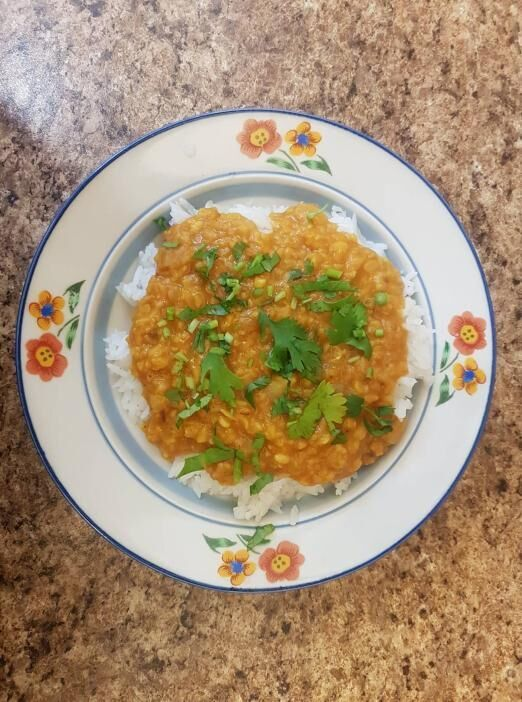

## Oil Mixture
- **5 cloves** finely chopped garlic
- **1 tsp** whole cumin seeds
- **&frac12; tsp** red chili flakes
- **2 tbsp** canola oil

Fry garlic, cumin seeds, and chili in oil on medium heat until garlic has
turned golden brown and cumin is fragrant. If using ground cumin, fry garlic
and chili, remove from heat and then add ground cumin. Put this oil mixture to
the side for later.

## Daal Tadka

- **&frac12; tsp** red chili flakes
- **1 inch** ginger
- **&frac12; tsp** turmeric powder
- **&frac12; tsp** garam masala
- **1 onion** chopped
- **2 medium tomatoes** finely chopped

OR

- **&frac13; can** crushed tomatoes
- **1 cup** split red lentils or split mung beans (or a mix of both)
- **2 tsp** canola oil
- **2.5 cups** water or soup stock
- **1&ndash;3 tsp** vinegar or lemon juice
- Salt to taste
- Cilantro (optional)

Fry garlic, cumin seeds, and chili in oil on medium heat until garlic has
turned golden brown and cumin is fragrant. If using ground cumin, fry garlic
and chili, remove from heat and then add ground cumin. Put this oil mixture to
the side for later.

Heat canola oil in a medium-sized pot on medium-high heat and sauté onions
until translucent. Add the spice paste and stir well for a minute. Add the
tomatoes, lentils/mung beans, and water/stock, reduce heat to low and cover.
Simmer until lentils/mung beans break apart and add vinegar/lemon juice to
taste. Remove from heat and add garlic/cumin/chili/canola oil mixture from
earlier. Stir well, top with cilantro, and serve over rice.

---

Tip: prepare the garlic/cumin/chili/canola oil mixture in a medium-sized pot,
move oil mix into a small bowl and use that same pot to prepare the
lentils/mung beans.

