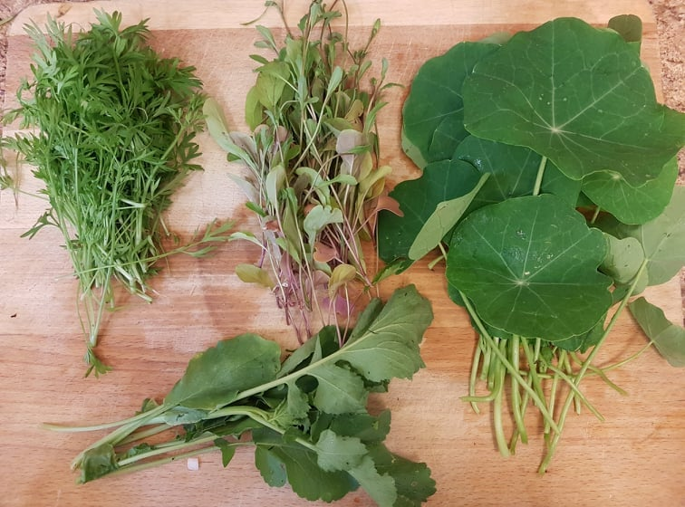
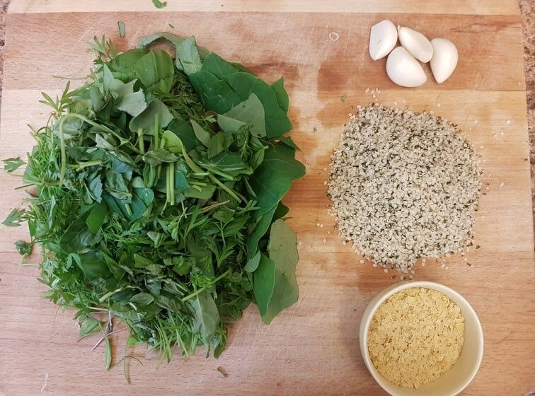
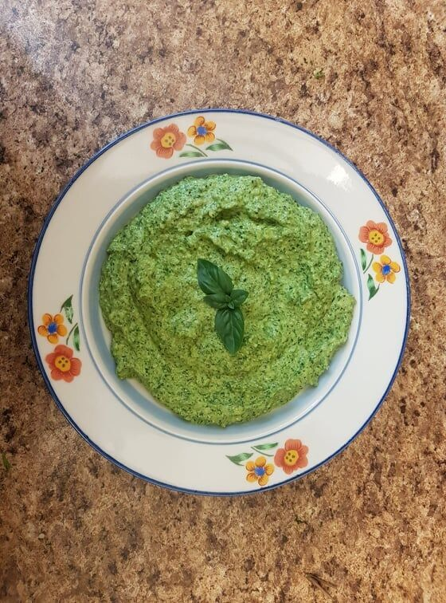

## Step 1: Gather Garden Greens

- 3 cups of mixed greens

Today I had to tidy up my container garden and I was able to make pesto with
all the greens I pulled out. I had to thin my carrots, pull out some arugula
that was starting to bolt, pinch back basil, harvest a couple of radishes and
pull out a nasturtium that had gotten too big.

This recipe can be made with almost any type
of leafy herb or green. This recipe yields about 2/3 cup of pesto

## Step 2: Prepare Ingredients

Cut and chop your garden greens, and gather:

- 4 Garlic cloves
- &frac14; cup of hemp hearts or sunflower seeds
- &frac14; cup of nutritional yeast
- &frac14; cup canola oil
- 3 tbsp lemon juice (juice of 1 lemon)
- Salt to taste

## Step 3: Mix and Eat

Mix all together in a food processor until fairly smooth. Add salt to taste.

Serve over pasta or on your next sandwich.

## Step 4: Freeze

Tip: Freeze any extra pesto sauce flat so that you can break off chunks.

A note on ingredients: traditionally pesto is made with olive oil and pine
nuts. I, like many of you, don’t have pine nut money so I use hemp hearts or
sunflower seeds when I make pesto. I didn’t have any olive oil in the house,
so I used canola and it worked well.
