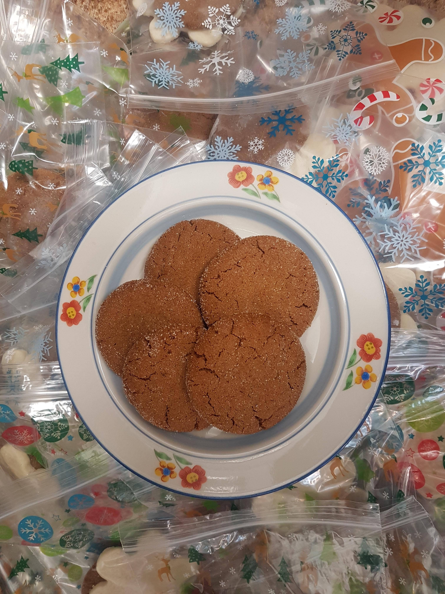

Ingredients:

- **&frac34; cup** Sugar, plus extra for rolling
- **&frac13; cup** fancy molasses
- **&frac12; cup** canola oil
- **3 tbsp** non-dairy milk (I prefer oat)
- **1 &frac34; cup** all-purpose flour
- **2 tbsp** ground ginger
- **1 &frac12; tsp** cinnamon
- **&frac12; tsp** cloves
- **&frac12; tsp** allspice
- **&frac12; tsp** nutmeg
- **1 tbsp** cocoa
- **&frac12; tsp** baking soda
- **&frac12; tsp** salt

Preheat the oven to 350F. Mix sugar, molasses, oil, and milk with an electric
mixer until smooth like caramel sauce (about 5 minutes). Mix the dry
ingredients together and add to the wet mixture slowly. Cover and allow the
dough to cool in the fridge for 3 hours.

Roll dough into 24 even balls, roll each ball in sugar, place on a cookie tray
lined with parchment paper, and flatten each ball slightly. Bake for 8-12
minutes, depending on how chewy or crispy you like your cookies. This dough can
also be rolled out and cut with cookie cutters if you’d like something a bit
more fancy.

---

