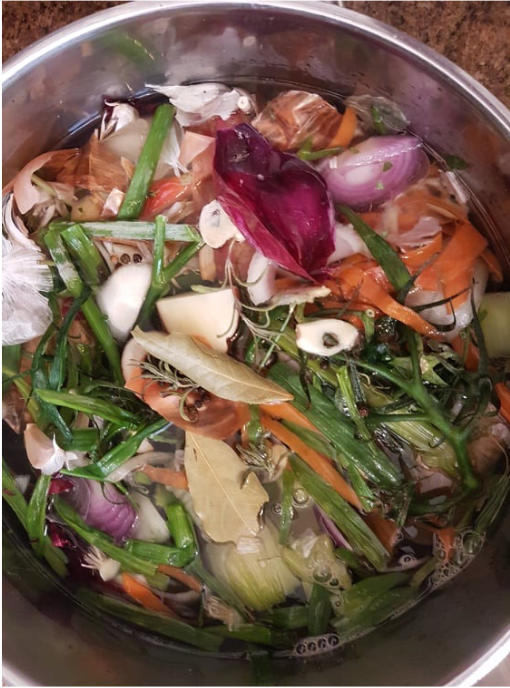
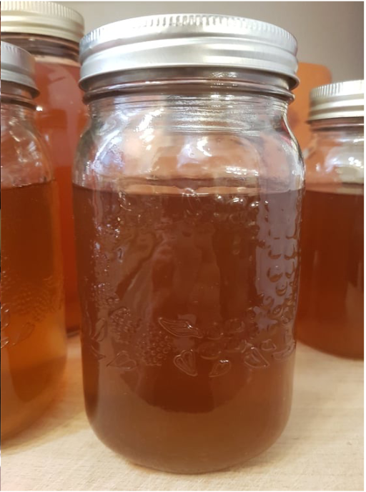

Vegetable broth is super easy to make at home with your kitchen scraps!

Collect any clean, non-moldy veggie scraps you produce in a large ziploc in
your freezer. Things like onions peels, herb stems, carrot or potato peels,
spinach that's about to go bad, or those tiny garlic cloves that are too hard
to peel are all fantastic additions to your broth-bag. Once your bag is full,
place the contents of the bag in a large pot and cover with water. You can add
black pepper, bay leaves, extra onions, or salt at this point if you'd like.
Simmer for 3-4 hours, cool, strain, and transfer into jars for storage. Make
sure to only fill jars up 3/4 of the way full if you're planning on freezing
them!

If you have a slow-cooker, you can also make broth on high for 8ish hours.

